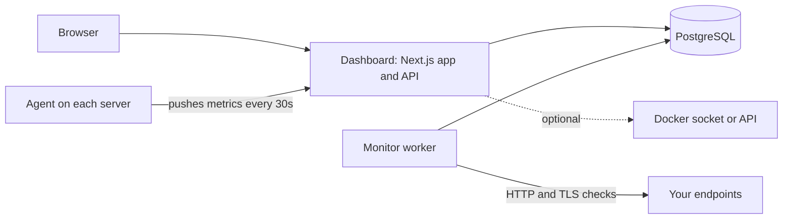

# DevSecOps Dashboard

Self-hosted monitoring for the machines and services you run yourself. It shows whether everything is OK at a glance, and what is wrong when something is not.

- **Servers**: CPU, memory, disk, load and network from a tiny Go agent (no dependencies, ~6 MB).
- **Endpoints**: HTTP(S) uptime, response time, status code and TLS certificate expiry.
- **Containers**: Docker state and logs, plus restart, stop and delete with a required reason and an audit trail.
- **Alerts**: open and close on their own based on thresholds, with acknowledgement.
- **Users and roles**: viewer, maintainer and admin.

## Install

On a Linux host with [Docker](https://docs.docker.com/engine/install/):

```bash
curl -fsSL https://raw.githubusercontent.com/Claritys11/DevSecOps-Dashboard/main/install.sh | bash
```

The installer:

1. downloads the dashboard to `~/devsecops-dashboard` (or `/opt/devsecops-dashboard` as root),
2. generates every secret and an admin password,
3. picks a free port (starting at 3000),
4. pulls or builds the image and starts it,
5. optionally installs the agent on the same machine, so you see data right away,
6. prints the URL and your login.

It asks three yes/no questions. Add `--yes` to accept the defaults, or see all options with `--help`:

```bash
curl -fsSL https://raw.githubusercontent.com/Claritys11/DevSecOps-Dashboard/main/install.sh | bash -s -- --port 8080 --with-docker --yes
```

Re-running the same command **updates** an existing install and keeps your `.env` and data.

## Add a server

1. In the dashboard, open **Servers** and click **Add server**.
2. Copy the command it shows. It looks like this:

   ```bash
   curl -fsSL http://192.168.1.10:3000/api/agents/install | sudo sh -s -- --url http://192.168.1.10:3000 --id nas-1a2b3c --token …
   ```

3. Run it on the machine you want to monitor. The server turns green within a minute.

The agent binary is served by your dashboard (amd64 and arm64), so monitored machines need nothing besides `curl` and systemd. To remove an agent, run `curl -fsSL <dashboard>/api/agents/install | sudo sh -s -- --uninstall`.

## Add an endpoint

Open **Endpoints**, click **Add endpoint**, paste a URL and save. The first check runs within seconds.

Local addresses (`192.168.x.x`, `10.x.x.x`, `localhost`) are allowed when you answered yes to the installer's local network question. This is stored as `MONITOR_ALLOW_PRIVATE_NETWORKS=true` in `.env`. Cloud metadata addresses are always blocked.

## Day-to-day

```bash
cd ~/devsecops-dashboard
docker compose ps              # status
docker compose logs -f app     # logs
docker compose down            # stop (data is kept)
docker compose up -d           # start again
```

| Task | How |
| --- | --- |
| Update | Re-run the install command |
| Change a setting | Edit `.env`, then `docker compose up -d` |
| Reset the admin password | Set `ADMIN_RESET_PASSWORD=true` in `.env`, run `docker compose up -d`, then set it back |
| Manage containers on this host | Re-install with `--with-docker`, or add `docker-compose.docker-socket.yml` to `COMPOSE_FILE` in `.env` |
| Put it behind a domain | Set `AUTH_URL=https://ops.example.com` in `.env` and proxy to `APP_PORT` |
| Uninstall | `bash install.sh --uninstall` (keeps data) or `--purge` (deletes data) |

All settings are documented in [docs/configuration.md](docs/configuration.md).

## How it works



Agents push outbound to the dashboard, so monitored machines do not need any open ports. Each agent has its own token. Only a hash of the token is stored, and every request is checked for timestamp, nonce and body hash. More detail is in [docs/architecture.md](docs/architecture.md).

## Security notes

- Mounting the Docker socket (`--with-docker`) gives the dashboard root-equivalent access to that host. Only enable it if you need container management.
- Protected containers (databases, proxies, the dashboard itself) are read-only in the UI. Every container action requires a reason and is logged.
- Sign-in is rate limited. Passwords are hashed with Argon2id.
- Serve the dashboard over HTTPS (reverse proxy) if it is reachable from outside your network.

See [SECURITY.md](SECURITY.md) for reporting vulnerabilities.

## Development

```bash
npm ci
npm run setup            # writes a development .env
docker compose -f docker-compose.yml -f docker-compose.dev.yml up -d postgres
npm run prisma:deploy && npm run prisma:seed
npm run agent:build      # optional: lets the dev server hand out agent binaries
npm run dev -- -p 3003
```

`npm run validate` runs lint, type checks, tests and a production build. See [CONTRIBUTING.md](CONTRIBUTING.md).

## Documentation

[Deployment](docs/deployment.md) · [Configuration](docs/configuration.md) · [Agent](docs/agent-installation.md) · [Upgrading](docs/upgrading.md) · [Troubleshooting](docs/troubleshooting.md) · [Architecture](docs/architecture.md)

## License

[Apache 2.0](LICENSE)
